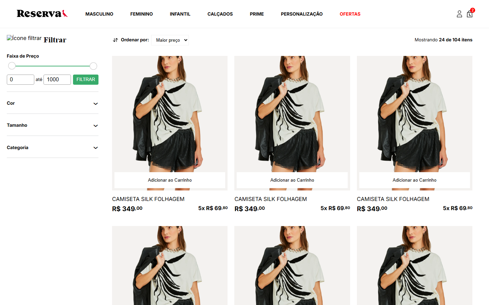
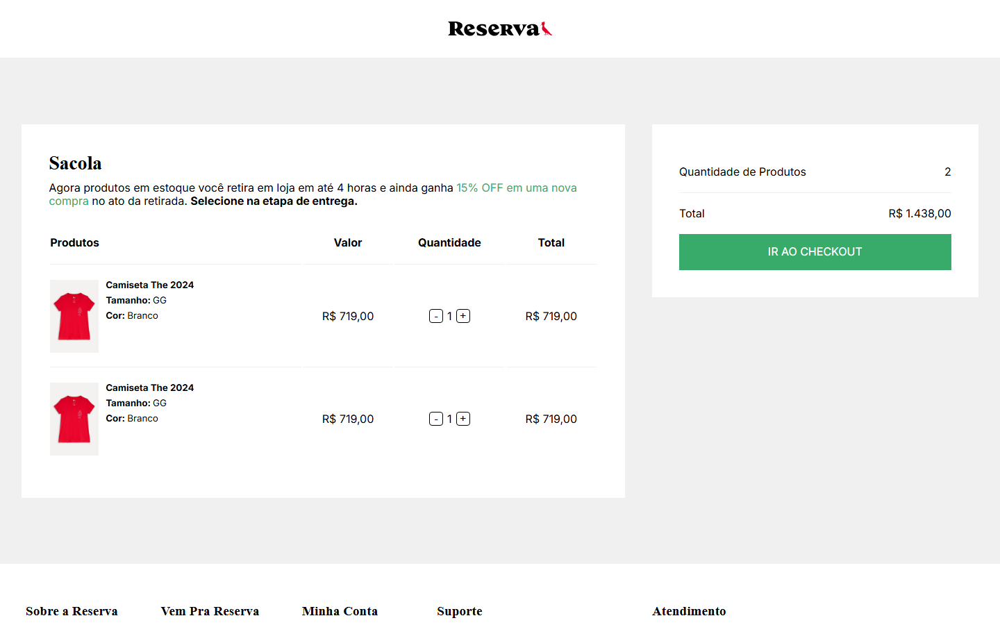
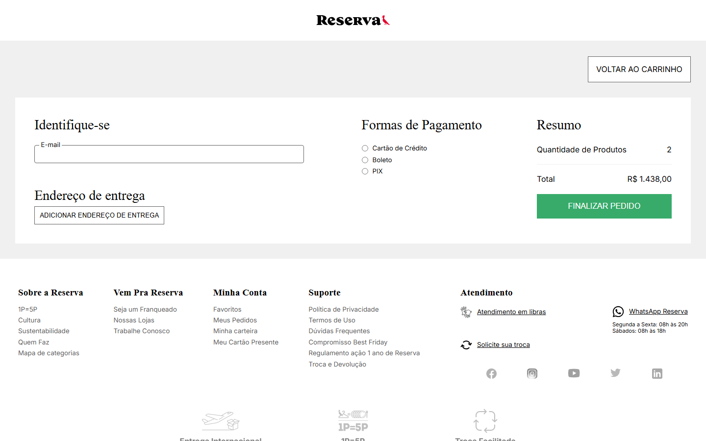
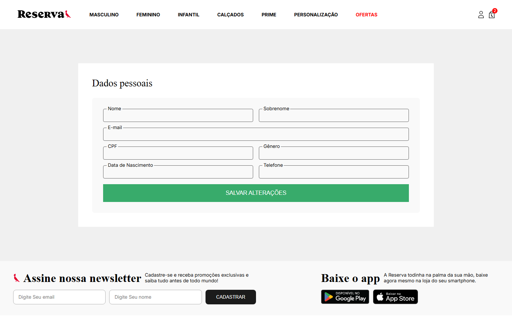
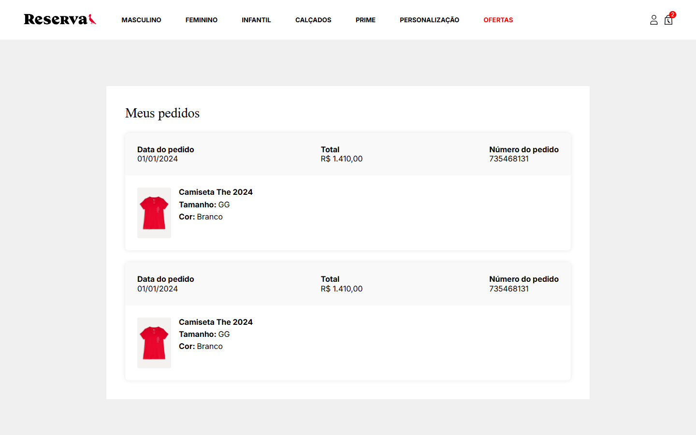

# E-commerce (SASS)

Projeto de front-end de um e-commerce de moda, inspirado na loja Reserva, desenvolvido com HTML, SASS e JavaScript puro.

🔗 **Acesse o projeto:** `https://daviobl2014-hub.github.io/ecommerce-sass/>/`

## Páginas

| Página                      | Arquivo             |
| --------------------------- | ------------------- |
| Home                        | `index.html`        |
| Loja (listagem com filtros) | `loja.html`         |
| Produto                     | `produtos.html`     |
| Carrinho                    | `carrinho.html`     |
| Checkout                    | `checkout.html`     |
| Minha conta                 | `minha-conta.html`  |
| Meus pedidos                | `meus-pedidos.html` |

## Prints do projeto

### Home


<details>
<summary>Versão mobile</summary>


</details>

### Loja



### Produto


### Carrinho



### Checkout



### Minha conta



### Meus pedidos



## Tecnologias utilizadas

- **HTML5**: estrutura semântica das páginas
- **SASS (SCSS)**: pré-processador CSS, organizado no padrão **7-1** (`abstracts`, `base`, `components`, `layout`, `pages`) e usando `@use` para os módulos
- **CSS3**: Flexbox, Grid, layout responsivo
- **Metodologia BEM**: nomenclatura das classes (ex.: `cabecalho__menu`, `carrossel__botao`)
- **JavaScript (Vanilla)**: interações sem framework:
  - menu do cabeçalho
  - carrossel da home e da página de produto
  - menu lateral expansível da loja
  - slider de faixa de preço
  - exibição do endereço no checkout
- **PostCSS + Autoprefixer**: adiciona prefixos de navegador ao CSS
- **npm-run-all**: executa a pipeline de build do CSS em sequência
- **Type scale**: escala tipográfica (Minor Third 1.200) e de espaçamentos (Major Third 1.250), veja `sistema-tamanhos.txt`

## Estrutura de pastas

```
├── index.html          # página inicial
├── *.html              # demais páginas
├── css/                # CSS compilado (main.css é o usado pelas páginas)
├── sass/
│   ├── abstracts/      # variáveis e auxiliares
│   ├── base/           # estilos base
│   ├── components/     # botões, carrossel, formulário, slider, produto
│   ├── layout/         # header e footer
│   ├── pages/          # estilos específicos de cada página
│   └── main.scss       # arquivo principal
├── js/                 # scripts das páginas
├── img/                # ícones e imagens
├── screenshots/        # prints usados neste README
└── Base Back-end/      # templates base para integração com back-end (Django)
```

## Como rodar localmente

Pré-requisito: [Node.js](https://nodejs.org/) instalado.

```bash
# instalar as dependências
npm install

# compilar o SASS em modo watch durante o desenvolvimento
npm run watch:sass

# gerar o CSS final (compila, adiciona prefixos e minifica)
npm run build:css
```

Depois é só abrir o `index.html` no navegador (ou usar uma extensão como o Live Server).

### Scripts disponíveis

| Script         | O que faz                                                  |
| -------------- | ---------------------------------------------------------- |
| `watch:sass`   | Compila `sass/main.scss` → `css/main.css` a cada alteração |
| `compile:sass` | Compila o SASS para `css/style.comp.css`                   |
| `prefix:css`   | Aplica o Autoprefixer, gerando `css/style.prefix.css`      |
| `compress:css` | Minifica o CSS final em `css/main.css`                     |
| `build:css`    | Executa as três etapas acima em sequência                  |
